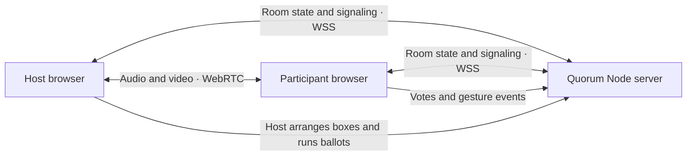

VELOS × QUORUM

### Move ideas. Shape the room. Decide together.

**A gesture-first presentation workspace paired with a spatial collaboration room.**

[Open Quorum](https://velos-workspace.onrender.com/quorum/) · [Check service health](https://velos-workspace.onrender.com/healthz)


</div>

<p align="center">
  
</p>

<p align="center"><sub>Illustrative animation; the live interface may differ.</sub></p>

Velos brings hand-tracked presentation controls and small-group facilitation into one workspace. In Quorum, a host can move participant boxes across a shared stage, create groups, set a motion, and run a ballot. People can vote with controls or supported hand gestures.

## Two spaces, one flow

| **Velos Presenter** | **Quorum** |
| --- | --- |
| Present built-in slides or a PDF. Use camera-based hand tracking for supported presentation controls, annotate, and share a screen. | Meet in a room with participant boxes, host-arranged groups, a facilitation center, live ballots, and gesture voting. |



The server coordinates room membership, host permissions, group layout, ballots, and WebRTC signaling. When the network allows it, browsers send audio and video directly to one another with WebRTC.

## What you can do

### Present with Velos

- Use the presenter workspace and its camera-based gesture controls.
- Present the built-in deck or open a local PDF.
- Share your screen and use the stage presentation controls.
- Open Quorum directly from the Velos workspace.

### Facilitate with Quorum

- Open a room or join with a room code and invite link.
- Arrange participant boxes by dragging them on the stage; create up to **eight groups**.
- Set a motion, open a timed or untimed ballot, and collect **yes / no / abstain** votes.
- Vote with the controls or supported hand gestures. Manual voting remains available if hand tracking is unavailable.
- Let the host view optional, self-reported participant profile details. Those profile fields are sent only to the host.
- Switch between front and rear phone cameras when the device and browser expose both.
- Share a tab, window, or display with the room. The browser asks for screen-sharing permission.
- Open one-click tools for Docs, Sheets, Slides, Drive, Maps, OpenStreetMap, Trello, Notion, GitHub, Miro, Excalidraw, Canva, Padlet, and Mermaid Live. External services may require an account.
- Use host-approved ShareView-style remote control **only when Quorum is running locally on the Windows computer being controlled**. This is not available from the Render-hosted service.

## Run it locally

### Requirements

- Node.js **18.11 or newer**
- A modern browser
- Internet access for MediaPipe hand tracking and external collaboration tools

### Start the server

```bash
npm install
npm start
```

Open [http://localhost:8788](http://localhost:8788). Choose **Velos Quorum** or **Velos Presenter** from the landing page. Keep the terminal open while using the local server; opening the HTML files directly from File Explorer will not start room signaling.

On Windows PowerShell, if `npm` is blocked by script policy:

```powershell
npm.cmd install
npm.cmd start
```

The default port is `8788`. If it is occupied, choose another port and open the matching address:

```powershell
$env:PORT=8898
npm.cmd start
```

### Check JavaScript syntax

```bash
npm run check
```

This command runs Node's syntax checker on the server and application scripts. It is not an end-to-end browser test suite.

## Deploy

### Render room server

The Node service is the Quorum WebSocket endpoint and the source of live room state. This repository includes a Render Blueprint in [`render.yaml`](render.yaml).

1. Connect the repository to Render and deploy the Blueprint.
2. Confirm the service is live and its health check returns `{"status":"ok"}` at `/healthz`.
3. Open `/quorum/` on the deployed service and create a room.
4. Keep the service to **one instance**: room state currently lives in that server process.

The current service URL is [`velos-workspace.onrender.com`](https://velos-workspace.onrender.com). Quorum pages opened on a `*.onrender.com` host connect to that same host automatically. If you use a different Render hostname, update the external-host fallback in [`quorum/quorum-config.js`](quorum/quorum-config.js) and [`quorum/quorum-app.js`](quorum/quorum-app.js), then redeploy the website.

### Optional Vercel website

Vercel can serve the website, while Render continues to handle Quorum WebSockets and shared room state. The client fallback in this project points Vercel-hosted Quorum pages at `wss://velos-workspace.onrender.com/quorum-space`. Deploy the same project revision to Vercel and Render so the page and the room server stay in sync.

Render's free service can spin down when idle. The first visit after inactivity may take **50 seconds or more** to wake the service. A restart or sleep cycle also clears active rooms because room data is not persisted.

## Join and invite

1. Open the deployed `/quorum/` page.
2. Enter a display name and choose **Open a room**. The first person in the room becomes host.
3. Use **Invite** in the room header to copy a link for that room.
4. Guests open the link, enter a name, and join the room.
5. As host, drag participant boxes into groups, set the motion, and open a ballot from the facilitation center.

## Privacy and operating limits

- There are no user accounts, password-protected rooms, or persistent room records. Anyone with a room link or code can attempt to join; do not use room codes as a privacy boundary.
- Names, presence, room layout, ballots, and signaling pass through the room server. The server keeps active room state in memory and clears it when the room ends or the process restarts.
- Audio and video use peer-to-peer WebRTC when the participants' networks allow it. The project includes public STUN servers, but no TURN relay; restrictive networks may need a TURN service for reliable media.
- Camera and microphone access require browser permission. Screen capture requires a separate browser permission and can be stopped by the person sharing.
- Hand tracking loads MediaPipe from a CDN and needs internet access. Manual controls remain available if tracking cannot start.
- The Windows remote-input feature can send mouse and keyboard actions to the computer running the local server. Only approve people you trust, and revoke control when it is no longer needed.
- The current room limit is **16 participants total** and **eight groups** per room.

## Project map

```text
.
├── index.html                 Velos landing page
├── assets/                    Brand marks and README hero animation
├── app/                       Velos presenter interface and styles
├── quorum/                    Quorum interface, styles, and browser client
├── server.js                  Static server, room state, WebSocket signaling
├── remote-input.js            Windows-only, host-approved local input bridge
├── render.yaml                Render service and health-check configuration
├── vercel.json                Vercel deployment configuration
└── package.json               Start, development, and syntax-check scripts
```

## Troubleshooting

| Symptom | Check |
| --- | --- |
| Quorum says the server is unavailable | Open `/healthz`, wait for a free Render service to wake, and confirm the Quorum client points at your current Render hostname. |
| A room link opens but people do not appear together | Make sure every participant uses the same deployed website and room code, and that the Render WebSocket service is live. |
| Camera or microphone will not start | Use `localhost` or HTTPS, then allow camera and microphone access in the browser. |
| Video does not connect on a restricted network | Configure a TURN relay; STUN alone is not sufficient on every network. |
| `EADDRINUSE` on port 8788 | Another process is using the port. Stop it or run the server on a different `PORT`. |

---

<div align="center">

**Present with intention. Arrange the room. Make the next move together.**

</div>
